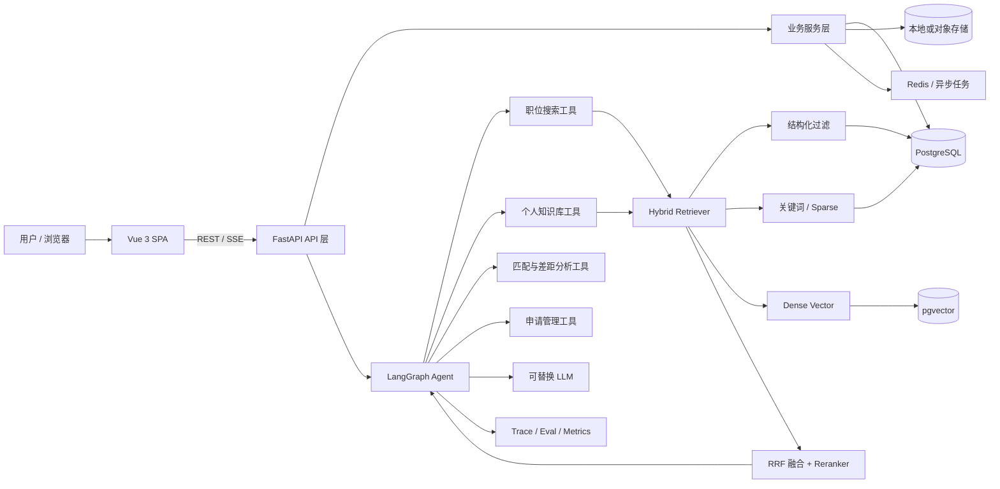
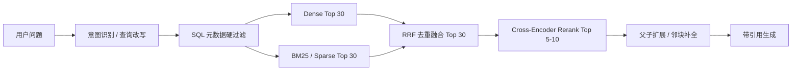
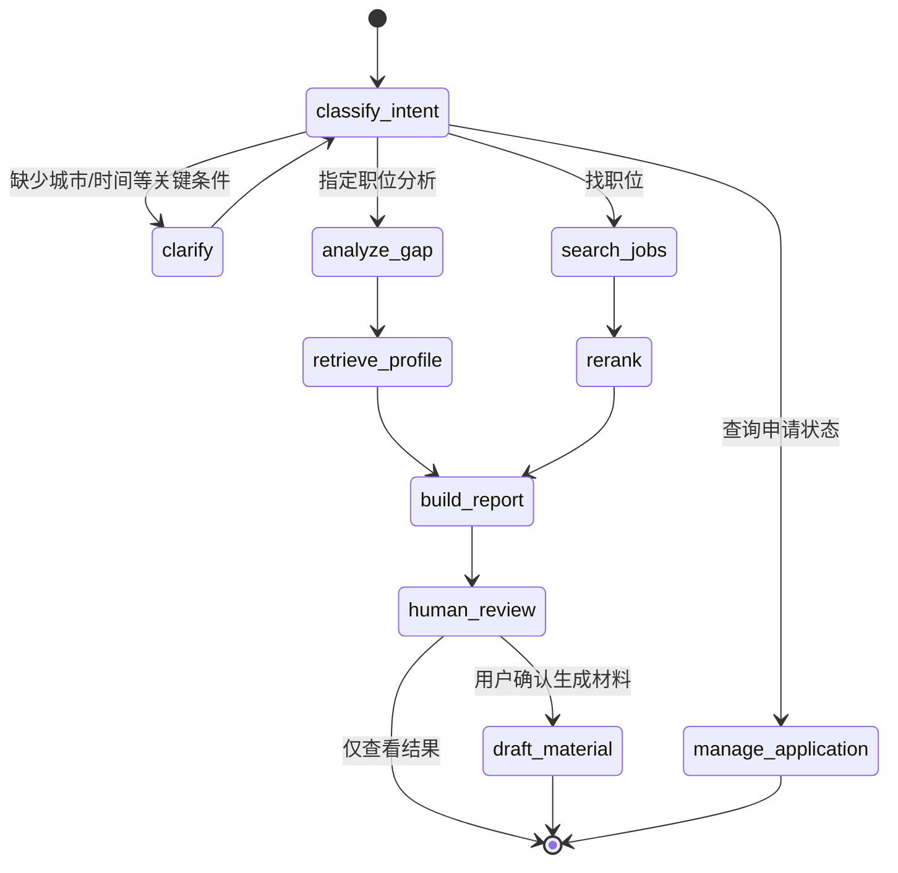
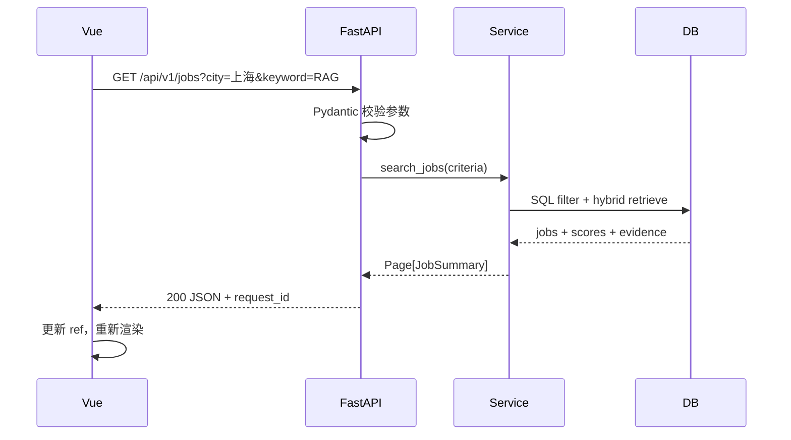

# CareerPilot：AI 应用开发实习求职 Agent 架构与实施规划

> CareerPilot 的原始求职系统架构与实施记录。`r`n
> 文档版本：v1.0  
> 适用目标：以一个可运行、可评测、可部署的项目，系统学习并展示 LangChain / LangGraph、RAG、Vue 3、FastAPI、RESTful API、PostgreSQL 与工程化能力。  
> 项目定位：帮助用户收集和理解 AI 应用开发实习职位，基于私人知识库匹配岗位、发现技能差距、生成有证据的求职建议，并管理申请流程。

---

## 1. 一页结论

项目名建议使用 **CareerPilot**，而不是做一个泛化“求职聊天机器人”。它应该解决一条完整、可演示的业务链路：

1. 用户上传简历、项目说明、课程笔记和目标偏好；
2. 系统导入用户提供的职位链接、职位文本或合规数据源；
3. 将职位解析为结构化字段，同时保留原文并建立分块索引；
4. 先用城市、实习周期、学历等硬条件过滤，再用混合检索和重排做语义匹配；
5. Agent 结合检索证据解释“为什么适合 / 缺什么 / 下一步做什么”；
6. 用户确认后生成定制材料、学习计划和面试题，绝不自动代投；
7. 系统记录申请状态与反馈，用反馈改进检索和排序。

推荐的首版技术组合：

| 层级 | 技术选择 | 使用目的 |
|---|---|---|
| 前端 | Vue 3 + TypeScript + Vite + Vue Router + Pinia + Axios | 单页应用、类型安全、状态管理、调用 REST API |
| UI | Element Plus（首版） | 快速完成职位表格、筛选器、抽屉和表单 |
| 后端 | FastAPI + Pydantic v2 + SQLAlchemy 2 + Alembic | API、数据校验、ORM、迁移 |
| Agent | LangChain + LangGraph | 模型/工具/Retriever 集成；有状态、可恢复、可人工确认的工作流 |
| 数据库 | PostgreSQL + pgvector | 业务数据、元数据和向量统一存储，便于做过滤检索 |
| 关键词检索 | PostgreSQL FTS 或 OpenSearch（数据量大后再上） | 补足技术名、缩写、版本号的精确匹配 |
| 缓存/任务 | Redis + ARQ/Celery（二期） | 去重、缓存、异步解析和批量向量化 |
| 可观测性 | LangSmith 或 OpenTelemetry + 自建评测表 | Trace、时延、Token、检索结果和错误分析 |
| 部署 | Docker Compose；前端 Nginx；后端 Uvicorn/Gunicorn | 可复现部署和面试演示 |

Embedding 的初始建议不是“永远选某一个”，而是：

- **中文职位匹配的优先基线**：`Qwen3-Embedding-0.6B`（本地开源、1024 维），与 BM25/全文检索组成混合检索；
- **最值得展示的对照组**：`BAAI/bge-m3`，因为它可同时提供 dense、sparse、multi-vector，并适合展示混合检索理解；
- **最低运维成本的 API 基线**：`text-embedding-3-small`，适合没有 GPU、希望快速上线的情况；
- **最终选择标准**：在你自己的“中文 JD + 个人材料”标注集上比较 Recall@5、MRR@10、nDCG@10、P95 延迟、索引速度和成本，而不是只看 MTEB 排行榜。

---

## 2. 为什么这个项目适合找 AI 应用开发实习

它能同时展示招聘要求中常见的五类能力：

- **LLM 应用**：Prompt、结构化输出、Tool Calling、Agent 状态机、记忆和人工确认；
- **RAG 深度**：数据清洗、语义分块、Hybrid Search、Rerank、引用、离线评测和错误分析；
- **后端工程**：FastAPI、RESTful API、鉴权、异步任务、数据库事务、缓存、测试；
- **前端工程**：Vue 组件化、响应式状态、路由、表单、流式对话和可视化解释；
- **工程闭环**：Docker、日志、监控、评测数据、README、架构图与线上 Demo。

与普通 Demo 的区别应体现在三个可量化问题上：

1. 检索是否真的更准，而不只是“能查到”？
2. Agent 为什么推荐这个岗位，能否引用 JD 和简历中的原始证据？
3. 改 Embedding、Chunk、Hybrid 和 Reranker 后，指标与成本发生了什么变化？

---

## 3. 产品范围

### 3.1 核心用户故事

| 编号 | 用户故事 | 验收结果 |
|---|---|---|
| U1 | 我上传 PDF/Markdown 简历和项目材料 | 能查看解析结果、原文来源和索引状态 |
| U2 | 我粘贴或导入职位描述 | 系统提取公司、地点、技能、经验、职责等字段，并保留原文 |
| U3 | 我按城市、是否日常实习、周期等过滤职位 | 硬条件过滤正确，URL 可复现 |
| U4 | 我询问“哪些岗位最适合我” | 返回带匹配分、证据、缺口和风险的排序结果 |
| U5 | 我打开某岗位的匹配报告 | 能看到硬条件、技能重合、语义相似度和证据来源 |
| U6 | 我要求制定补强计划 | 基于岗位要求和私人学习资料生成任务，不编造已掌握技能 |
| U7 | 我开始申请 | 状态从收藏、准备、已投递、面试到 Offer 可追踪 |
| U8 | 我反馈推荐是否相关 | 反馈进入评测集和排序特征，支持后续迭代 |

### 3.2 MVP 明确不做

- 不绕过登录、验证码或网站限制批量爬取；优先处理用户粘贴内容、上传文件、公开 API 和允许抓取的数据源；
- 不自动投递简历或代表用户发送消息；所有外部副作用必须人工确认；
- 不一开始上微服务、Kubernetes、Kafka 或独立向量数据库；10 万级 Chunk 内 PostgreSQL + pgvector 足够完成学习和作品展示；
- 不让 LLM 直接决定最终匹配分；结构化规则、检索分、重排分和 LLM 解释要分离。

---

## 4. 总体架构



### 4.1 分层原则

```text
Vue 页面
  -> REST API / SSE
  -> FastAPI Router（HTTP 语义、鉴权、参数校验）
  -> Application Service（业务用例、事务边界）
  -> Domain / Repository（职位、资料、申请、检索）
  -> PostgreSQL / pgvector / 外部模型
```

关键约束：

- Router 不写 Prompt，不直接拼 SQL；
- Agent Tool 只能调用业务 Service，不能随意操作数据库；
- Retriever 返回统一 `RetrievedEvidence`，包含来源、Chunk、分数和元数据；
- LLM 只负责语义理解与解释，确定性过滤和权限校验由代码完成；
- 每次 Agent 执行都有 `run_id`，可复盘调用了什么工具、检索了什么证据。

---

## 5. 推荐代码仓库结构

```text
career-pilot-ai/
├─ apps/
│  ├─ web/                         # Vue 3 + TypeScript
│  │  ├─ src/
│  │  │  ├─ api/                  # Axios client 和按资源划分的请求函数
│  │  │  ├─ components/
│  │  │  ├─ composables/          # useJobSearch、useAgentStream
│  │  │  ├─ router/
│  │  │  ├─ stores/               # Pinia
│  │  │  ├─ types/                # 由 OpenAPI 生成的类型优先
│  │  │  └─ views/
│  │  └─ tests/
│  └─ api/                         # FastAPI
│     ├─ app/
│     │  ├─ api/v1/               # routers
│     │  ├─ agents/               # graph、state、nodes、tools
│     │  ├─ core/                 # config、security、logging
│     │  ├─ db/                   # session、models、migrations
│     │  ├─ domains/              # jobs、profiles、applications
│     │  ├─ rag/                  # ingest、chunk、embed、retrieve、rerank、eval
│     │  ├─ schemas/              # Pydantic request/response
│     │  └─ main.py
│     └─ tests/
├─ evals/
│  ├─ datasets/                    # 脱敏后的 gold queries/qrels
│  ├─ experiments/                # 实验配置
│  └─ reports/                    # 可提交的对比报告
├─ data/samples/                   # 可公开的样例简历与 JD
├─ docs/
├─ infra/
│  ├─ docker-compose.yml
│  └─ nginx.conf
├─ .env.example
├─ Makefile
└─ README.md
```

建议使用一个 Monorepo。对于个人项目，它比拆成多个仓库更容易启动、测试和展示。

---

## 6. 领域数据设计：哪些要结构化，细分到什么程度

### 6.1 结论：采用“结构化字段 + 原文 + 语义 Chunk”三份互补表示

只存向量会导致过滤困难、数据不可解释；把所有文本都拆成数据库列又会丢失上下文且维护成本过高。正确做法是：

| 数据形态 | 用途 | 示例 |
|---|---|---|
| 结构化字段 | 精确过滤、排序、统计、去重 | 城市、学历、实习周期、技能数组、发布日期 |
| 原始文档 | 审计、重新解析、展示引用 | 原始 JD、简历 PDF 提取文本、来源 URL |
| 语义 Chunk | 向量/关键词检索与引用 | “岗位职责”“必须技能”“项目经历：RAG 系统” |

### 6.2 职位表 `jobs`

建议结构化到“用户会过滤、排序、聚合，或需要精确判断”的程度：

```text
id, source, source_job_id, source_url, content_hash
company_name, title, job_family, employment_type
city, district, remote_type
salary_min, salary_max, salary_period, currency
education_level, experience_min_months
internship_days_per_week, internship_months
published_at, expires_at, collected_at
required_skills[], preferred_skills[]
responsibilities[], qualifications[]
benefits[]
raw_text, parse_version, parse_confidence
status, created_at, updated_at
```

不要过度结构化：

- “沟通能力强”“对 AI 有热情”等软性描述保留在 qualification Chunk 中即可；
- 每条职责不需要建一张关系表，除非后续需要跨职位统计；早期可用 JSONB/数组；
- 技能应做规范化映射，例如 `Vue.js`、`Vue3` -> `vue`，但同时保留原始文本；
- 对 `LangChain 0.x`、`RAG`、`LoRA` 等精确词，关键词索引通常比纯向量更可靠。

### 6.3 私人知识库

建议分成四个 namespace，检索时不要把全部内容无差别混在一起：

| namespace | 内容 | 推荐 Chunk 粒度 |
|---|---|---|
| `profile` | 教育、城市、实习时间、偏好 | 每个稳定事实一个记录，带 `valid_from/to` |
| `experience` | 项目、实习、竞赛、成果 | 一个项目概述 + 每条 STAR/成果一个子 Chunk |
| `skills` | 已掌握技能及证据 | 一个技能一个记录，必须关联项目/课程证据 |
| `learning` | 笔记、文章、面试资料 | 按标题层级和语义段落分块 |

私人文档 Chunk 元数据建议：

```json
{
  "user_id": "...",
  "document_id": "...",
  "namespace": "experience",
  "section_path": ["项目经历", "CareerPilot", "检索优化"],
  "chunk_type": "achievement",
  "skills": ["rag", "pgvector", "fastapi"],
  "source_page": 2,
  "visibility": "private",
  "valid_at": "2026-07-01",
  "parser_version": "resume-v2",
  "embedding_model": "...",
  "content_hash": "..."
}
```

### 6.4 分块细度

不要把“固定 500 字切一刀”当成最终方案。职位和简历本身是半结构化文档，应优先按字段与标题切：

1. 先按 `岗位职责 / 任职要求 / 加分项 / 公司介绍` 分节；
2. 再按列表项或自然段形成原子 Chunk；
3. 给原子 Chunk 补上父级标题和职位标题，避免其脱离语境；
4. 对过长段落再做递归切分；
5. 检索命中子 Chunk 后，可扩展相邻 Chunk 或返回父节作为上下文。

建议起始参数，不是固定真理：

- JD 列表项：80–300 中文字符通常直接作为一个 Chunk；
- 学习笔记：300–600 中文字符，重叠 50–100 字；
- 项目经历：每个成果/职责单独成块，同时保留 150–300 字项目摘要；
- 一个 Chunk 只表达一个主要事实，但必须带足够标题上下文；
- 使用 Token 计数器检查模型上限，不要只按 Python 字符数估算。

需要通过实验比较：`固定长度`、`标题感知`、`父子分块` 三种策略。在相同 Embedding 下记录 Recall@5 与上下文 Token 数，防止“召回提升只是因为塞入更多文本”。

---

## 7. RAG 检索链路：怎样真正提高精度

### 7.1 推荐的两阶段检索



每一步解决的问题不同：

- **查询改写**：把“我适合哪些大模型应用岗”补成检索意图和同义词，但必须保留原查询；
- **元数据过滤**：城市、日期、学历等是布尔事实，不该交给向量相似度猜；
- **Dense**：召回同义表达，例如“检索增强生成”与“RAG”；
- **Sparse/BM25**：召回精确技术词、版本、公司名和缩写；
- **RRF**：不强行比较两种不可直接比较的原始分数，按排名融合；
- **Reranker**：对 query-document pair 做更细的相关性判断，成本高，所以只处理候选集；
- **上下文扩展**：防止只返回一句要求而丢失所属岗位与限定条件；
- **引用生成**：答案中的每个关键判断指向具体职位或个人材料 Chunk。

RRF 可从下面的简单形式开始：

```text
score(d) = Σ 1 / (k + rank_i(d))，k 可先取 60
```

### 7.2 Agent 检索前必须做意图路由

| 意图 | 检索范围 | 示例 |
|---|---|---|
| 找职位 | `jobs` + profile 硬条件 | “上海有哪些适合我的 RAG 实习？” |
| 解释匹配 | 指定 job + `experience/skills` | “为什么我适合这个岗位？” |
| 技能差距 | job requirements + `skills/experience` | “我还缺什么？” |
| 学习问答 | `learning`，必要时再联网 | “解释 HNSW 的 ef_search” |
| 申请状态 | 关系数据库，不走向量库 | “哪些公司一周没回复？” |

如果所有问题都对同一个 Collection 做相似度搜索，结果很容易串库。

### 7.3 提升准确率的优先级

按照通常投入产出比，建议依次做：

1. 建立 100–300 条真实标注 Query 与相关文档；
2. 修复解析、去重、结构化字段和 Chunk 上下文；
3. 加元数据过滤和 BM25 + Dense 混合召回；
4. 加 Reranker；
5. 做失败查询分析和同义词/技能规范化；
6. 再考虑换更大 Embedding、微调或上复杂多向量检索。

没有评测集时，“换模型变准了”往往只是主观感觉。

---

## 8. 不同 Embedding 模型对精度、效率和成本的影响

### 8.1 影响到底可能有多大

公开基准只能说明潜在能力。以 Qwen 官方模型卡记录的同一版基准为例：

- 多语言 Retrieval：Qwen3-Embedding-0.6B 为 64.64，BGE-M3 为 54.60，差 **10.04 个绝对分**；
- 多语言 Retrieval：Qwen3-Embedding-0.6B 为 64.64，multilingual-e5-large-instruct 为 57.12，差 **7.52 个绝对分**；
- C-MTEB 中文 Retrieval：Qwen3-Embedding-0.6B 为 71.03，multilingual-e5-large-instruct 为 63.65，差 **7.38 个绝对分**。

这说明换模型可能造成明显差异，但不能把这些数字直接当成你的 Recall@5 提升：公开基准混合了多个任务，模型卡结果也不等于你的 JD 数据分布。项目中应该将这些分数视为“候选筛选依据”，用自建 qrels 得出最终结论。

### 8.2 候选模型表

| 模型 | 参数/维度/上下文 | 强项 | 代价与风险 | 项目角色 |
|---|---|---|---|---|
| Qwen3-Embedding-0.6B | 约 0.6B / 1024 / 32K | 中文与多语言公开检索成绩强；开源；可指令化；模型体积相对可控 | 本地 CPU 延迟需实测；长输入不代表应该做超长 Chunk | **中文 dense 首选基线** |
| BAAI/bge-m3 | 约 0.6B / 1024 / 8K | 100+ 语言；dense、sparse、multi-vector 三种模式；适合混合检索 | 计算和存储设计更复杂；公开榜单上不保证每个中文领域最佳 | **RAG 深度对照组 / Hybrid 候选** |
| multilingual-e5-large-instruct | 约 0.6B / 1024 / 512 左右常用上限 | 经典多语言强基线，生态成熟 | 上下文较短；使用 query instruction/prefix 才公平 | 稳健对照组 |
| text-embedding-3-small | API / 默认 1536 / API 限制以官方为准 | 接入最简单，无本地 GPU 运维；可缩短维度 | 私人文本出域、网络依赖、持续 API 成本；中文领域必须实测 | **云 API 成本基线** |

注：模型版本、限制和价格可能变化，实验配置必须保存模型精确名称、依赖版本、归一化方法、Prompt/prefix 和日期。

### 8.3 “哪个效率最好、性价比最高”的分场景答案

| 场景 | 推荐 | 原因 |
|---|---|---|
| 本地开发、中文为主、愿意用 GPU/较强 CPU | Qwen3-Embedding-0.6B | 模型规模较小，中文公开检索结果很有竞争力，数据不出本机 |
| 想展示高级 Hybrid / 多向量能力 | BGE-M3 | 一个模型覆盖 dense、sparse、multi-vector，技术展示价值高 |
| 没有 GPU，语料不敏感，希望最快上线 | text-embedding-3-small | API 运维成本最低；官方当前页面列出的标准输入价为每百万 Token 0.02 美元，仍需以使用时价格为准 |
| 数据量少于 10 万 Chunk、希望少维护组件 | PostgreSQL + pgvector HNSW | 与业务过滤和权限数据同库，开发效率高 |
| 数百万以上向量、复杂全文检索和分布式需求 | 再评估 OpenSearch/Qdrant/Milvus | 这是规模驱动的升级，不应为了“技术栈更多”提前引入 |

**本项目推荐决策**：MVP 先落地 `Qwen3-Embedding-0.6B + PostgreSQL FTS + RRF + bge-reranker-v2-m3`；同时实现 Embedding Adapter，在评测脚本中对比 BGE-M3 与 API 基线。若本机条件不足，则先用 API 跑通功能，再用离线批处理完成本地模型实验。

### 8.4 向量维度对存储和搜索的影响

未计索引和元数据时，float32 原始向量约占 `向量数 × 维度 × 4 bytes`：

| 10 万条向量 | 原始向量体积（约） |
|---|---:|
| 384 维 | 146 MiB |
| 768 维 | 293 MiB |
| 1024 维 | 391 MiB |
| 1536 维 | 586 MiB |

HNSW 还会额外保存图索引，实际空间更高。不要因为“维度越高信息越多”就认定更准：高维会增加存储、内存带宽和距离计算成本，精度仍由训练质量与任务匹配决定。可把 pgvector `halfvec` 或模型的 Matryoshka 降维作为独立实验，但必须重新测 Recall，不能只测速度。

### 8.5 向量索引建议

- 小数据集最初可做精确搜索，作为近似索引 Recall 的真值；
- MVP 使用 HNSW，通常能得到较好的速度-召回折中，且不要求先训练索引；
- IVFFlat 建索引更快、内存较少，但需要合理设置 lists/probes，速度-召回折中通常弱于 HNSW；
- 必须记录 `m`、`ef_construction`、`ef_search` 或 IVFFlat 的 `lists/probes`；
- 过滤后候选很少时，SQL 精确检索可能比 ANN 更合适；
- 用 exact search 对同一批查询计算 ANN Recall，不能只记录查询耗时。

---

## 9. RAG 离线评测与实验设计

### 9.1 Gold 数据集

第一版构建 150 条 Query：

- 50 条职位发现：技术栈、城市、实习周期、行业组合查询；
- 40 条职位-个人经历匹配；
- 30 条技能差距问题；
- 20 条技术名词/缩写精确查询；
- 10 条负例或无答案问题。

每条数据保存：

```json
{
  "query_id": "q-001",
  "query": "需要 Vue 和 FastAPI 的上海 AI 应用实习",
  "intent": "job_search",
  "filters": {"city": "上海"},
  "relevant_chunk_ids": ["..."],
  "relevance_grades": {"chunk-a": 3, "chunk-b": 1},
  "must_contain_facts": ["vue", "fastapi"],
  "must_not_claim": ["用户已经掌握 Vue"],
  "annotator_note": "..."
}
```

至少抽取 20% 数据做第二次人工复核；把公司名和个人信息脱敏后，可将样例评测集提交到 GitHub。

### 9.2 核心指标

| 层次 | 指标 | 意义 |
|---|---|---|
| 检索 | Recall@5/10 | 相关证据是否被召回 |
| 排序 | MRR@10、nDCG@10 | 最相关结果是否排在前面，兼顾分级相关性 |
| 过滤 | Filter accuracy | 城市、日期、学历等硬条件是否正确 |
| 生成 | Citation precision/coverage | 引用是否支持结论、关键结论是否都有引用 |
| 生成 | Faithfulness / Answer correctness | 是否仅依据证据、答案是否正确 |
| 系统 | P50/P95、吞吐、错误率 | 用户体验与稳定性 |
| 成本 | 每千次查询费用、每万 Chunk 建库时间 | 可持续性和性价比 |

### 9.3 最小实验矩阵

不要一次改变多个变量。按下面顺序做消融实验：

| 实验 | 唯一变化 | 需要回答的问题 |
|---|---|---|
| E1 | 固定 Chunk，比较 3 个 Embedding | 模型本身影响多大？ |
| E2 | 固定模型，比较固定/标题感知/父子 Chunk | 数据粒度影响多大？ |
| E3 | Dense vs BM25 vs Hybrid | 混合检索是否补回精确技术词？ |
| E4 | Hybrid 前后加入 Reranker | Top 结果是否改善，增加多少延迟？ |
| E5 | 1024 vs 可支持的降维/halfvec | Recall 损失能否换来足够的成本收益？ |
| E6 | HNSW 不同 ef_search | 延迟与 ANN Recall 的拐点在哪里？ |

综合选择可以使用可解释权重：

```text
score = 0.35 × Recall@5
      + 0.20 × nDCG@10
      + 0.15 × Citation precision
      + 0.15 × normalized(P95 latency)
      + 0.10 × normalized(cost)
      + 0.05 × privacy/deployment score
```

权重应在实验报告中说明。招聘匹配更怕漏掉好岗位，所以 Recall 权重最高。

建议的发布门槛：

- Gold set Recall@5 ≥ 0.85；
- Filter accuracy ≥ 0.98；
- Citation precision ≥ 0.95；
- 在线检索 P95 < 800 ms（不含最终 LLM 生成）；
- 生成端无法找到证据时明确回答“不确定”，不伪造用户经历。

这些是项目目标，不是对特定模型的预先承诺。

---

## 10. LangChain / LangGraph 怎样做到不浅显

### 10.1 LangChain 的职责

LangChain 用于组件集成，而不是把全部逻辑塞进一个 `create_agent()`：

- Document Loader 与自定义 Parser；
- Text Splitter 的基线实现；
- Embeddings Adapter，屏蔽本地/API 模型差异；
- 自定义 `HybridRetriever` 和 `Reranker`；
- Prompt Template 与 Pydantic 结构化输出；
- Runnable 链、批处理、流式输出、重试；
- 回调与 Trace。

核心业务对象和数据库 Repository 仍应是普通 Python 代码，以便测试和替换框架。

### 10.2 LangGraph 状态机



建议状态：

```python
class AgentState(TypedDict):
    thread_id: str
    user_id: str
    messages: list
    intent: str | None
    filters: dict
    candidate_job_ids: list[str]
    evidence: list[dict]
    match_report: dict | None
    pending_action: dict | None
    errors: list[dict]
```

非浅层使用点：

- Checkpoint 持久化：页面刷新或任务失败后可恢复；
- Human-in-the-loop：生成材料、修改申请状态前暂停确认；
- 幂等 Tool：相同 `idempotency_key` 不重复导入职位或创建申请；
- Tool 权限：查询工具只读，写工具要求用户确认；
- 状态不要只放聊天历史，要保存过滤器、证据、候选职位和错误；
- 每个 Node 有输入/输出 Schema 和单元测试；
- 失败时返回可诊断错误，不让模型无限循环调用工具。

### 10.3 防幻觉约束

- 匹配报告中的“已掌握技能”必须引用 `experience/skills` 证据；
- JD 原文只说明“岗位要求”，不能反向证明用户会该技能；
- 将 `evidence_id` 作为结构化输出字段，再由后端校验引用是否存在；
- 对薪资、地点、日期使用数据库字段，不从生成文本二次解析；
- 当证据不足时输出 `unknown`，前端展示“需要补充资料”；
- Prompt Injection 防御：导入的 JD/文档是数据，不是系统指令；Tool 参数由服务端校验。

---

## 11. FastAPI 与 RESTful API 快速入门

### 11.1 先建立正确心智模型

- **FastAPI** 是 Python Web 框架；负责接收 HTTP 请求、校验数据、调用业务逻辑、返回 JSON；
- **REST** 是围绕资源设计 HTTP 接口的一组风格，不是某个库；
- **OpenAPI** 是机器可读的接口合同；FastAPI 会根据类型自动生成 `/docs` 和 `/openapi.json`；
- **Pydantic** 定义请求/响应形状并做运行时校验；
- **SQLAlchemy** 负责数据库对象映射，不应把 ORM Model 直接当所有 API Schema 使用。

### 11.2 先掌握这组 HTTP 语义

| 动作 | 方法与路径 | 成功状态码 | 是否幂等 |
|---|---|---:|---|
| 查询职位列表 | `GET /api/v1/jobs` | 200 | 是 |
| 查询单个职位 | `GET /api/v1/jobs/{job_id}` | 200 | 是 |
| 创建职位 | `POST /api/v1/jobs` | 201 | 通常否 |
| 替换全部字段 | `PUT /api/v1/jobs/{job_id}` | 200 | 是 |
| 修改部分字段 | `PATCH /api/v1/jobs/{job_id}` | 200 | 是 |
| 删除职位 | `DELETE /api/v1/jobs/{job_id}` | 204 | 是 |

常见错误：400 请求不合法、401 未认证、403 无权限、404 不存在、409 冲突、422 字段校验失败、429 限流、500 服务端错误。

### 11.3 最小 FastAPI 示例

```python
from typing import Annotated
from fastapi import FastAPI, Query
from pydantic import BaseModel, Field

app = FastAPI(title="CareerPilot API", version="1.0.0")

class JobCreate(BaseModel):
    title: str = Field(min_length=2, max_length=100)
    company_name: str
    city: str | None = None
    raw_text: str = Field(min_length=20)

class JobRead(JobCreate):
    id: str

@app.get("/api/v1/jobs", response_model=list[JobRead])
async def list_jobs(
    keyword: Annotated[str | None, Query(max_length=100)] = None,
    city: str | None = None,
    limit: Annotated[int, Query(ge=1, le=100)] = 20,
) -> list[JobRead]:
    # 实际项目调用 job_service.search(...)，不要在 Router 中直接写 SQL
    return []

@app.post("/api/v1/jobs", response_model=JobRead, status_code=201)
async def create_job(payload: JobCreate) -> JobRead:
    # 实际项目调用 job_service.create(payload)
    return JobRead(id="demo-id", **payload.model_dump())
```

运行后先用 `/docs` 手工调用，再写 pytest。若调用的数据库/HTTP 客户端提供 async API，就用 `async def + await`；CPU 密集的 PDF 解析或本地 Embedding 不要直接阻塞事件循环，应交给线程池、进程或任务队列。

### 11.4 本项目 REST API 草案

```text
POST   /api/v1/documents                 上传私人材料
GET    /api/v1/documents/{id}            查看解析/索引状态
POST   /api/v1/jobs/import               导入职位文本或允许的 URL
GET    /api/v1/jobs                      过滤、分页、排序
GET    /api/v1/jobs/{id}                 职位详情
POST   /api/v1/jobs/{id}/match           生成/刷新匹配报告
GET    /api/v1/jobs/{id}/match           获取已有报告
POST   /api/v1/search                    执行可解释搜索
POST   /api/v1/agent/runs                创建 Agent Run
GET    /api/v1/agent/runs/{id}/events    SSE 流式事件
POST   /api/v1/agent/runs/{id}/resume    人工确认后继续
POST   /api/v1/applications              创建申请记录
PATCH  /api/v1/applications/{id}         更新状态
POST   /api/v1/feedback                  记录相关性反馈
GET    /api/v1/evals/experiments/{id}    获取实验报告
```

列表接口统一使用：

```json
{
  "items": [],
  "page": 1,
  "page_size": 20,
  "total": 0
}
```

错误接口统一使用：

```json
{
  "code": "JOB_NOT_FOUND",
  "message": "职位不存在或已被删除",
  "details": {},
  "request_id": "req_..."
}
```

### 11.5 FastAPI 一周速成顺序

1. 路由、Path/Query/Body、Pydantic、状态码和 `/docs`；
2. Dependency Injection、配置、异常处理、CORS；
3. SQLAlchemy Session、Repository、事务、Alembic；
4. JWT/Session 鉴权和 `user_id` 数据隔离；
5. async/await、SSE、Background Task 与真正任务队列的区别；
6. pytest + HTTPX/TestClient、依赖覆盖；
7. Docker、日志、健康检查和部署。

---

## 12. Vue 3 快速入门

### 12.1 心智模型

浏览器中的 Vue 负责三件事：

1. 根据响应式状态渲染界面；
2. 监听点击、输入等用户事件；
3. 调用 FastAPI，把 JSON 结果写回状态，界面自动更新。

优先学习 Vue 3 Composition API 和 `<script setup lang="ts">`：

| 概念 | 你需要会什么 | 本项目练习点 |
|---|---|---|
| `ref/reactive` | 响应式状态 | 搜索词、加载状态、筛选器 |
| `computed` | 派生状态 | 已选技能数量、按钮是否可用 |
| `watch` | 观察副作用 | 筛选器变化后更新 URL/防抖搜索 |
| Props/Emits | 父子组件通信 | JobCard 接收 job，发出 favorite 事件 |
| `v-if/v-for/v-model` | 条件、列表、双向表单 | 职位列表和搜索表单 |
| 生命周期 | `onMounted` 等 | 页面进入时加载职位 |
| Vue Router | 页面与参数 | `/jobs/:id` |
| Pinia | 跨页面状态 | 当前用户、搜索条件、收藏 |
| Composable | 复用逻辑 | `useJobSearch()`、`useSSE()` |

### 12.2 Vue 调 FastAPI 的最小示例

```vue
<script setup lang="ts">
import { onMounted, ref } from 'vue'
import axios from 'axios'

type Job = {
  id: string
  title: string
  company_name: string
  city: string | null
}

const jobs = ref<Job[]>([])
const keyword = ref('RAG')
const loading = ref(false)
const errorMessage = ref('')

async function searchJobs() {
  loading.value = true
  errorMessage.value = ''
  try {
    const response = await axios.get('/api/v1/jobs', {
      params: { keyword: keyword.value, page: 1, page_size: 20 }
    })
    jobs.value = response.data.items
  } catch (error) {
    errorMessage.value = '加载失败，请稍后重试'
  } finally {
    loading.value = false
  }
}

onMounted(searchJobs)
</script>

<template>
  <main>
    <form @submit.prevent="searchJobs">
      <input v-model="keyword" placeholder="输入技能或职位" />
      <button :disabled="loading">{{ loading ? '搜索中' : '搜索' }}</button>
    </form>
    <p v-if="errorMessage">{{ errorMessage }}</p>
    <ul v-else>
      <li v-for="job in jobs" :key="job.id">
        {{ job.company_name }} · {{ job.title }} · {{ job.city ?? '地点未知' }}
      </li>
    </ul>
  </main>
</template>
```

开发时使用 Vite proxy 把 `/api` 转发到 FastAPI，生产环境由 Nginx 同源反向代理，可减少 CORS 和 Cookie 配置问题。

### 12.3 前端页面规划

| 页面 | 首版内容 | 可体现的 Vue 能力 |
|---|---|---|
| `/onboarding` | 偏好、简历上传、解析确认 | 多步骤表单、上传、校验 |
| `/jobs` | 搜索、组合过滤、分页、职位卡片 | Router Query、Composable、列表状态 |
| `/jobs/:id` | JD、匹配雷达/条形分、证据和差距 | 动态路由、组件拆分、可解释 UI |
| `/chat` | Agent 对话、工具步骤、引用 | SSE 流式更新、消息状态机 |
| `/applications` | 看板和时间线 | Pinia、拖放可二期再做 |
| `/settings/knowledge` | 文档、Chunk、索引版本 | 表格、抽屉、轮询任务状态 |
| `/evals` | 模型与 Chunk 实验报告 | 图表、对比表、筛选 |

### 12.4 Vue 学习时应避免的坑

- 不要把所有状态都放 Pinia；页面局部状态保留在组件/Composable；
- 不要在模板中写复杂业务计算，用 `computed`；
- 列表必须使用稳定业务 ID 作为 `:key`，不要用 index；
- 为 loading、empty、error、partial 四种状态都设计 UI；
- API 类型不要手工维护两套，后期从 FastAPI OpenAPI 生成 TypeScript 类型；
- Token 不应放在可被任意脚本读取的长期存储中；正式项目优先安全 Cookie 并做好 CSRF 设计。

### 12.5 Vue 一周速成练习

1. 第 1 天：Vite 创建 Vue TS 项目，实现静态 JobCard；
2. 第 2 天：`ref/computed/v-model/v-for` 做可搜索本地列表；
3. 第 3 天：Vue Router 做列表页和详情页；
4. 第 4 天：Axios 调 FastAPI，完整处理 loading/error/empty；
5. 第 5 天：Pinia 保存用户偏好和筛选条件；
6. 第 6 天：封装 `useJobSearch`，为组件写测试；
7. 第 7 天：实现 SSE Agent 输出和引用卡片。

---

## 13. 前后端接口协作方法

以 OpenAPI 为唯一合同：



开发顺序：先定义 Pydantic 请求/响应和示例 -> 在 Swagger `/docs` 验证 -> 生成前端类型 -> 写 Vue API client -> 接页面。这样能快速理解 RESTful API，也能避免前后端字段名反复对不上。

---

## 14. Agent 工具设计

| Tool | 输入 | 输出 | 副作用/权限 |
|---|---|---|---|
| `search_jobs` | query + typed filters | job summaries + evidence | 只读 |
| `get_job` | job_id | structured job + raw citation | 只读 |
| `search_profile_evidence` | query + namespaces | personal evidence | 只读且仅当前用户 |
| `calculate_match` | job_id + user_id | deterministic score breakdown | 可缓存、无外部副作用 |
| `build_gap_plan` | job_id | prioritized gaps + evidence | 只读 |
| `draft_resume_bullets` | job_id | draft + cited source facts | 生成草稿 |
| `create_application` | job_id | application | **需要确认** |
| `update_application_status` | id + status | updated application | **需要确认、审计** |

匹配总分建议由可解释特征组成，而不是 LLM 随口给 87 分：

```text
hard_gate = 城市/时间/学历等不可违反条件
match_score =
    0.35 × required_skill_coverage
  + 0.20 × preferred_skill_coverage
  + 0.20 × experience_semantic_score
  + 0.10 × project_domain_score
  + 0.10 × preference_score
  + 0.05 × freshness_score
```

LLM 负责从证据生成解释，并可提议标准化技能；最终技能映射和分数由后端计算。权重后续可用用户的相关/不相关反馈学习，但第一版保持透明。

---

## 15. 数据安全与合规

- 所有业务表、向量行、对象存储 Key 都包含 `user_id`，Repository 层强制作用域；
- 私人材料默认不进入公开样例或外部评测平台；
- 原文、解析文本、Chunk 和向量都提供删除路径；删除文档必须级联删除索引；
- 日志不记录完整简历、Cookie、API Key 或 Prompt 中的敏感原文；
- 记录模型提供商、数据出域设置和用户同意；敏感数据优先本地 Embedding；
- 职位抓取遵守来源网站条款、robots 和速率限制；演示版优先粘贴导入/公开数据；
- 外部写操作使用人工确认、审计日志和幂等 Key；
- 导入文档视为不可信数据，隔离其中的 Prompt Injection 文本。

---

## 16. 测试与可观测性

### 16.1 测试金字塔

- 单元测试：技能规范化、Chunk、RRF、匹配分、Schema 校验；
- Repository 集成测试：PostgreSQL/pgvector 查询、用户隔离、事务；
- API 测试：状态码、分页、错误格式、鉴权、OpenAPI；
- Agent 测试：固定模型输出或 Fake Model，检查节点路由与 Tool 权限；
- RAG 回归：每次模型/Chunk/索引改动跑 Gold set；
- 前端测试：Composable、关键组件、表单和错误态；
- E2E：上传简历 -> 导入 JD -> 搜索 -> 匹配报告 -> 收藏。

### 16.2 每次 Run 应记录

```text
request_id, run_id, user_id_hash
intent, rewritten_queries, filters
retriever/version, embedding/model/version
candidate_ids and dense/sparse/rerank scores
prompt_version, model_name, token_usage
node latency, total latency, error_code
citations, user_feedback
```

用户隐私正文不要直接进入普通日志；需要调试时使用受控、可过期的 Trace。

---

## 17. 分阶段开发计划（8 周，可压缩为 6 周）

### 第 1 周：Vue + FastAPI + REST 入门纵切

- Vue 完成职位列表、详情和搜索表单；
- FastAPI 完成 `/jobs` CRUD、Pydantic Schema 和 Swagger；
- 前端 Axios 联调，理解 GET/POST/PATCH、状态码、CORS；
- PostgreSQL + SQLAlchemy + Alembic；
- 交付：不含 AI 的“职位管理器”，已有前后端完整链路。

### 第 2 周：数据导入与知识库

- 简历/JD 文本导入、Hash 去重、原文保存；
- 结构化抽取 Schema，加入解析置信度与人工修正页；
- 标题感知 Chunk、元数据和索引版本；
- 交付：可观察每个文档如何变成结构化字段和 Chunk。

### 第 3 周：检索基线与评测集

- 实现 PostgreSQL FTS/BM25 类关键词检索与 pgvector dense 检索；
- 建立首批 100–150 条 Query/qrels；
- 跑 E1/E2，对比 Embedding 与 Chunk；
- 交付：第一份可复现检索报告，不依赖 LLM 主观评分。

### 第 4 周：Hybrid、Rerank 与可解释匹配

- RRF 融合、Cross-Encoder Reranker、父子扩展；
- 硬条件 Gate、技能规范化和分项匹配分；
- Vue 匹配报告展示证据、分数来源与技能缺口；
- 交付：Dense/BM25/Hybrid/Rerank 消融对比。

### 第 5 周：Agent 工作流

- LangGraph 的意图路由、检索、报告、人工确认节点；
- Checkpoint、恢复、幂等 Tool、最大步数；
- SSE 流式展示 Agent 状态和引用；
- 交付：Agent 不只聊天，能可靠执行可恢复工作流。

### 第 6 周：申请管理和个性化

- Application 看板、时间线、反馈；
- 基于真实个人证据生成简历要点和技能补强计划；
- 对生成结果做引用校验；
- 交付：从发现岗位到准备申请的产品闭环。

### 第 7 周：工程质量

- 权限、删除、Prompt Injection、限流；
- 测试、Trace、评测回归、失败样例分析；
- Docker Compose、初始化数据、健康检查；
- 交付：他人能按 README 一键运行。

### 第 8 周：求职包装

- 录制 3–5 分钟 Demo；
- README 放架构图、指标表、成本表、失败案例与取舍；
- 准备 3 个面试故事：检索优化、异步/状态恢复、前后端契约；
- 交付：线上 Demo、公开样例、实验报告、演示视频和简历描述。

如果压缩到 6 周：合并第 2/3 周、合并第 6/7 周；不要删掉评测和测试，只减少页面美化与申请看板功能。

---

## 18. 每个里程碑的验收标准

| 里程碑 | 完成定义 |
|---|---|
| M1 全栈骨架 | Vue 可通过 REST 完成 Job CRUD；OpenAPI、数据库迁移、前后端测试可运行 |
| M2 RAG 基线 | 文档可追溯到 Chunk；至少 2 个 Embedding 和 3 个 Chunk 策略有评测结果 |
| M3 高精度检索 | 有 Filter + Hybrid + Rerank；报告包含 Recall/MRR/P95/成本和失败样例 |
| M4 Agent | 工作流可中断恢复；外部写动作需确认；回答有可点击引用 |
| M5 可交付产品 | Docker 一键启动；脱敏 Demo 数据；核心 E2E 通过；README 可让陌生人运行 |

---

## 19. 面试时如何讲这个项目

不要只说“用了 LangChain 和向量数据库”，建议按问题—决策—证据表达：

> 我发现纯向量检索会漏掉 Vue 3、RAG、LoRA 等短技术词，也无法可靠处理城市和实习周期，所以将硬条件放入 PostgreSQL 过滤，将全文检索与 Dense 结果通过 RRF 融合，再用 Cross-Encoder 重排。我构建了 N 条中文 JD 查询集，对 Embedding、Chunk 和检索链路做消融，最终 Recall@5 从 A 提升到 B，P95 增加 C ms；所有数字均可由 `evals/` 中的脚本复现。

简历项目描述模板（完成实验后再填真实数字）：

- 设计并实现 Vue 3 + FastAPI 的 AI 实习求职 Agent，使用 LangGraph 构建可持久化、可人工确认的职位检索与申请准备工作流；
- 构建 PostgreSQL/pgvector 私人 RAG，将职位结构化过滤、BM25、Dense Retrieval、RRF 和 Reranker 组合，在 N 条标注查询上将 Recall@5 从 A 提升至 B；
- 建立 Embedding/Chunk/HNSW 消融评测与可追溯引用机制，在 P95 为 X ms、单次成本 Y 的约束下选择性价比最高配置；
- 基于 FastAPI OpenAPI 自动生成前端类型，使用 Docker Compose 部署，并通过 API、Agent、RAG 回归和 E2E 测试保证核心流程。

严禁在简历中预填本文给出的目标指标；必须替换成实际实验结果。

---

## 20. 今天即可开始的任务清单

1. 建 Monorepo：`apps/web` 和 `apps/api`；
2. 用 20 份脱敏/公开 JD 定义 `JobCreate/JobRead` Schema；
3. 实现 FastAPI `/jobs` 列表、详情、创建和 PATCH；
4. 用 Vue 做职位列表与详情，并从 `/openapi.json` 理解请求/响应；
5. 建 PostgreSQL 表和第一次 Alembic migration；
6. 手工写 20 条查询及相关职位，作为评测集种子；
7. 先跑一个 Dense baseline，保存配置和结果；
8. 再加关键词检索，不要先写 Agent；
9. 检索可评测后再接 LangGraph；
10. 每周把架构、指标、失败案例更新到 README。

---

## 21. 建议阅读的第一手资料

- [Vue 3 官方快速开始](https://vuejs.org/guide/quick-start.html)
- [Vue 3 Composition API FAQ](https://vuejs.org/guide/extras/composition-api-faq.html)
- [FastAPI First Steps 与自动 OpenAPI 文档](https://fastapi.tiangolo.com/tutorial/first-steps/)
- [FastAPI Request Body / Pydantic](https://fastapi.tiangolo.com/tutorial/body/)
- [FastAPI async/await](https://fastapi.tiangolo.com/async/)
- [LangGraph Overview](https://docs.langchain.com/oss/python/langgraph/overview)
- [LangGraph Persistence](https://docs.langchain.com/oss/python/langgraph/persistence)
- [pgvector 官方 README：HNSW 与 IVFFlat](https://github.com/pgvector/pgvector/blob/master/README.md)
- [BGE-M3 官方模型卡](https://huggingface.co/BAAI/bge-m3)
- [Qwen3-Embedding-0.6B 官方模型卡与评测表](https://huggingface.co/Qwen/Qwen3-Embedding-0.6B)
- [multilingual-e5-large-instruct 模型卡](https://huggingface.co/intfloat/multilingual-e5-large-instruct)
- [OpenAI text-embedding-3-small 模型与当前价格](https://developers.openai.com/api/docs/models/text-embedding-3-small)

---

## 22. 最终技术路线决策记录（ADR 摘要）

| 决策 | 选择 | 理由 | 何时重新评估 |
|---|---|---|---|
| 业务库与向量库 | PostgreSQL + pgvector | 降低运维复杂度，结构化过滤与向量同库 | 超过百万级且性能/功能测量证明不足 |
| Agent 编排 | LangGraph + LangChain 组件 | 显式状态、持久化、恢复、人工确认 | 简单问答链可直接用 Runnable，不强行进图 |
| 检索 | Filter + BM25 + Dense + RRF + Rerank | 同时覆盖硬条件、精确词和语义 | 用消融证明某一层无收益时删减 |
| Embedding | Qwen3-0.6B 为起始基线，BGE-M3/API 为对照 | 中文能力、隐私、展示价值和部署成本平衡 | 每次换语料域或硬件后重跑评测 |
| 数据表示 | 字段 + 原文 + Chunk | 查询效率、审计和语义召回兼得 | 某字段需要频繁统计时从 JSONB 提升为列 |
| API | REST + SSE | CRUD 清晰；Agent 输出可流式 | 真正双向实时协作再考虑 WebSocket |
| 前端 | Vue 3 Composition API + TS | 对应招聘栈，生态成熟，适合快速学习 | 不为追新频繁换框架 |

这份项目的真正竞争力不是组件数量，而是你能用数据解释每项架构决策，并能展示失败、评测与改进过程。


